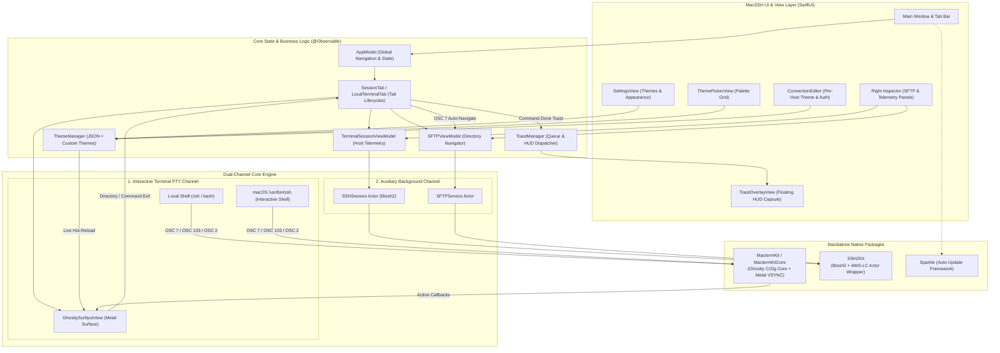

# MacSSH

[English](README.md) | [简体中文](README.zh-CN.md)

`MacSSH` is a modern, fast, and native **SSH & SFTP client** handcrafted for macOS.

Built entirely with SwiftUI and Swift 6 strict concurrency, it features Metal-accelerated terminal rendering powered by the Ghostty emulator engine (`MactermKit`) and robust SSH2 session handling via an isolated SPM package (`SSH2Kit`).

---

## 🏛️ Architecture & Dual-Channel Engine

To ensure non-blocking terminal responsiveness and maintain clean module boundaries, `MacSSH` implements a **Dual-Channel Architecture**:

1. **Interactive Terminal Channel (PTY)**: Directly drives the interactive shell session via Ghostty and macOS native `/usr/bin/ssh` (or expect scripts for stored credentials), rendering directly on Metal GPU with full ANSI TrueColor, IME input support, and semantic Shell Integration.
2. **Auxiliary Telemetry & SFTP Channel**: A dedicated Swift actor-isolated `SSHSession` and `SFTPService` via `SSH2Kit` (wrapping `libssh2` and `AWS-LC`), providing background directory navigation, file transfers, and real-time host metric polling without interfering with interactive terminal PTY traffic.



---

## ✨ Core Features

- ⚡ **Metal-Accelerated VT**: Powered by the Ghostty terminal core, offering 120Hz VSYNC-synchronized rendering, sub-millisecond latency, and full ANSI TrueColor / 256-color support.
- 🎨 **Curated Theme Ecosystem & Live Hot Reloading**: Over 110+ curated color schemes (Tokyo Night, Catppuccin, Dracula, Nord, Gruvbox, One Dark, Solarized, Warm Beige Cream, and Slate Dark) with adaptive Dark/Light system pairing, per-connection theme overrides, and instant live reloading across all active sessions.
- 🪄 **Native Shell Integration & Productivity HUD**:
  - **OSC 7 Working Directory Tracking**: Automatically synchronizes the right SFTP Inspector to the active remote shell directory.
  - **OSC 0 / OSC 2 Title Updates**: Dynamic window and tab titles driven by remote shell processes.
  - **Zero-Dependency Toast HUD**: Floating status toasts alerting command completion time and exit codes for long-running commands, paired with background system notifications.
- 🔀 **Split Panes & Local Shells**: Multi-directional split panes (horizontal & vertical) with independent PTY lifecycles, plus native local macOS shell tabs.
- 📊 **Real-time Host System Monitoring**: Full-width capsule progress indicators for CPU, memory, swap, disk, network throughput, and load averages.
- 📁 **Visual SFTP Inspector**: Integrated sidebar file manager supporting recursive transfers, drag-and-drop uploads, and directory navigation.
- 🛡️ **Dual-Channel Concurrency Isolation**: Built on Swift 6 strict concurrency, completely separating interactive terminal PTY traffic from background SFTP and telemetry tasks to prevent stalls.
- 🔑 **Keychain Security & Robust Key Handling**: Seamless `.pub` to private key resolution, secure macOS Keychain integration, and StrictHostKeyChecking trust prompts.
- 🔄 **Sparkle 2.x Auto-Updates**: Secure, seamless in-app update checks signed with EdDSA keys.

---

## 🛠️ Build from Source

### Prerequisites

1. **macOS 15.0+** running on Apple Silicon (`arm64`).
2. **Xcode 16+** with macOS SDK.
3. **Tuist**: Ensure Tuist is installed (`mise install tuist` or `curl -fsSL https://get.tuist.io | bash`).

### Generating & Building Project

```bash
# 1. Clone repository
git clone https://github.com/SteveShi/MacSSH.git
cd MacSSH

# 2. Generate workspace via Tuist
tuist generate --no-open

# 3. Build via xcodebuild
xcodebuild -workspace MacSSH.xcworkspace -scheme MacSSH -configuration Debug build
```

---

## 📄 License

`MacSSH` is released under the [MIT License](LICENSE).
