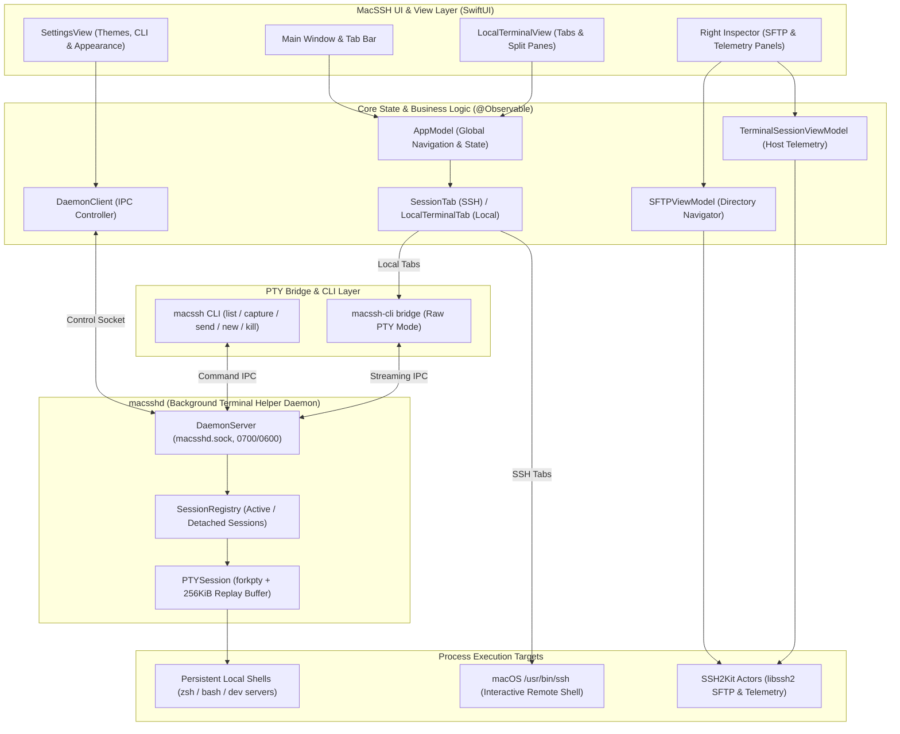

# MacSSH

[English](README.md) | [简体中文](README.zh-CN.md)

`MacSSH` is a modern, fast, and native **SSH, SFTP, and Local Terminal client** handcrafted for macOS.

Built entirely with SwiftUI and Swift 6 strict concurrency, it features Metal-accelerated terminal rendering powered by the Ghostty emulator engine (`MactermKit`), robust SSH2 session handling via an isolated SPM package (`SSH2Kit`), and a persistent background terminal helper (`macsshd`) paired with a native command-line interface (`macssh-cli` / `macssh`).

---

## 🏛️ Architecture & Core Components

To deliver non-blocking responsiveness, resilient background task persistence, and clean module boundaries, `MacSSH` implements a **Multi-Channel & Client–Daemon Architecture**:

1. **Interactive Terminal Channel (PTY)**: Drives the interactive shell session via Ghostty and macOS native `/usr/bin/ssh` (or expect scripts for stored credentials), rendering directly on the Metal GPU with full ANSI TrueColor, IME input support, and semantic Shell Integration (OSC 7 / OSC 133 / OSC 2).
2. **Persistent Terminal Helper Daemon (`macsshd`)**: An on-demand background daemon that owns native POSIX pseudo-terminals (`forkpty` + `execve`). Detaches sessions when MacSSH quits (`Cmd+Q`) or updates via Sparkle, maintaining unbroken execution for dev servers, build tasks, and background jobs.
3. **Transparent PTY Bridge & CLI (`macssh-cli` / `macssh`)**: A dual-purpose binary that bridges `GhosttySurfaceView` with `macsshd` in `cfmakeraw` mode, while exposing a powerful command-line interface for scripts, Raycast/Alfred, and AI coding agents.
4. **Auxiliary Telemetry & SFTP Channel**: A dedicated Swift actor-isolated `SSHSession` and `SFTPService` via `SSH2Kit` (wrapping `libssh2` and `AWS-LC`), providing background directory navigation, file transfers, and real-time host metric polling without interfering with interactive terminal PTY traffic.



---

## ⚡ Persistent Terminal Helper (`macsshd`)

`macsshd` is MacSSH's dedicated background helper daemon, designed to decouple local terminal execution from the graphical window lifecycle.

### Why `macsshd`?

- **Zero-Interrupt Detach & Reattach**: When you quit MacSSH (`Cmd+Q`), close a window, or restart for a Sparkle auto-update, your local terminal sessions are non-destructively **detached** rather than killed. Long-running tasks (`npm run dev`, `cargo watch`, `xcodebuild`, Docker containers, and interactive REPLs) continue running uninterrupted in the background.
- **256 KiB Raw VT Replay Ring Buffer**: `macsshd` maintains an in-memory 256 KiB circular output buffer for each session. When MacSSH relaunches or reattaches, the raw VT byte stream is replayed into Ghostty's parser to instantly reconstruct colors, cursor position, and scrollback history. It also sends `SIGWINCH` (`redrawForeground()`) to the foreground process group so full-screen TUI apps (Vim, Htop, Claude Code) redraw cleanly.
- **Anti-Truncation Paste Protection**: Large pastes and Bracketed Paste payloads that exceed macOS XNU kernel PTY limits (`TTYHOG` ~1022 bytes) are safely queued in `pendingInput` via `DispatchSourceWrite`, preventing data loss on `EAGAIN`.
- **Non-Blocking Process Reaping**: Uses `waitpid(pid, &status, WNOHANG)` polling on a dedicated dispatch queue, eliminating control-thread deadlocks.
- **On-Demand Lifecycle & Strict Security**: Communicates over a private Unix domain socket at `~/Library/Application Support/MacSSH/run/macsshd.sock` (mode `0600`, parent directory `0700`) with peer UID verification (`getpeereid`). Spawns automatically in an independent session (`POSIX_SPAWN_SETSID`) on demand, and gracefully shuts down after 30 seconds of idle time only when no sessions exist.

---

## 💻 Command-Line Interface (`macssh` / `macssh-cli`)

`macssh-cli` is embedded directly inside `MacSSH.app/Contents/MacOS/macssh-cli`. You can install the `macssh` symlink to `/usr/local/bin/macssh` (or `~/.local/bin/macssh`) with one click in **Settings → Terminal**, or manually:

```bash
sudo ln -sf "/Applications/MacSSH.app/Contents/MacOS/macssh-cli" /usr/local/bin/macssh
```

### Command Reference

| Command | Description | Example |
| :--- | :--- | :--- |
| `macssh list` (`ls`) | List all active and detached sessions | `macssh list` |
| `macssh capture <target>` | Print visible screen text as headless snapshot | `macssh capture 1` |
| `macssh capture <target> --full` | Print visible screen and full scrollback buffer | `macssh capture 1 --full` |
| `macssh capture <target> --last` | Print only the output of the last executed command | `macssh capture 1 --last` |
| `macssh send <target> ...` | Inject text and tmux-compatible keys into session | `macssh send 1 text "git status" key Enter` |
| `macssh new [--name] [--cwd] [-- cmd]` | Create a persistent background session | `macssh new --name "Build" --cwd ~/Repo` |
| `macssh kill <target>` | Terminate a running session (`SIGHUP` → `SIGKILL`) | `macssh kill 1` |
| `macssh detach <target>` | Detach attached clients without stopping session | `macssh detach 1` |
| `macssh status` | Check daemon PID, version, and active session count | `macssh status` |
| `macssh ssh <[user@]host[:port]>` | Open or focus an SSH connection in MacSSH | `macssh ssh root@example.com` |

#### Key Vocabulary for `macssh send`

`macssh send` supports all standard `tmux send-keys` key names:
```text
Enter, Return, Tab, Escape, Esc, Space, BSpace, Backspace, Delete, DC, IC, Insert,
Up, Down, Right, Left, Home, End, PgUp, PgDn, F1-F12, C-<key>, M-<key>
```

#### Examples

```bash
# 1. Start a persistent background dev server
macssh new --name "WebDev" --cwd ~/Projects/my-app -- npm run dev

# 2. Check running sessions
macssh list
# Output:
# ID  NAME    PROCESS  PID    SIZE   STATE     DIRECTORY             KEY
# 1   WebDev  node     82140  80x24  detached  ~/Projects/my-app     a1b2c3d4...

# 3. Capture the dev server output from another script or terminal
macssh capture 1

# 4. Inject a Ctrl+C to stop it gracefully
macssh send 1 key C-c
```

---

## ✨ Core Features

- ⚡ **Metal-Accelerated VT**: Powered by the Ghostty terminal core, offering 120Hz VSYNC-synchronized rendering, sub-millisecond latency, and full ANSI TrueColor / 256-color support.
- 🛡️ **Client–Daemon Session Persistence (`macsshd`)**: Local terminal sessions run in the background. App quit or Sparkle update detaches sessions without killing processes; reattach restores full 256 KiB screen state.
- 💻 **Automation CLI (`macssh`)**: Comprehensive command-line control for listing, capturing headless terminal output, sending keystrokes, and spawning sessions.
- 📦 **Background Sessions UI**: One-click "Detach Tab to Background" (`Cmd+Shift+D`), toolbar "Background Sessions" menu with live process badges, and instant reattachment.
- 🎨 **Curated Theme Ecosystem**: 110+ curated color schemes (Tokyo Night, Catppuccin, Dracula, Nord, Gruvbox, One Dark, Solarized, Warm Beige Cream, and Slate Dark) with adaptive Dark/Light system pairing and instant live reloading.
- 🪄 **Native Shell Integration & Productivity HUD**:
  - **OSC 7 Working Directory Tracking**: Automatically synchronizes the right SFTP Inspector to the active remote shell directory.
  - **OSC 0 / OSC 2 Title Updates**: Dynamic window and tab titles driven by shell processes.
  - **Zero-Dependency Toast HUD**: Floating status toasts alerting command completion time and exit codes for long-running commands (>=5s), paired with background system notifications.
- 🔀 **Split Panes & Local Shells**: Multi-directional split panes (horizontal & vertical) with independent PTY lifecycles, plus native local macOS shell tabs.
- 📊 **Real-time Host System Monitoring**: Full-width capsule progress indicators for CPU, memory, swap, disk, network throughput, and load averages.
- 📁 **Visual SFTP Inspector**: Integrated sidebar file manager supporting recursive transfers, drag-and-drop uploads, and directory navigation.
- 🛡️ **Dual-Channel Concurrency Isolation**: Built on Swift 6 strict concurrency, completely separating interactive terminal PTY traffic from background SFTP and telemetry tasks.
- 🔑 **Keychain Security & Robust Key Handling**: Seamless `.pub` to private key resolution, secure macOS Keychain integration, and StrictHostKeyChecking trust prompts.
- 🔄 **Sparkle 2.x Auto-Updates**: Secure, seamless in-app update checks signed with EdDSA keys.

---

## 🛠️ Build from Source

### Prerequisites

1. **macOS 15.0+** running on Apple Silicon (`arm64`).
2. **Xcode 16+** with macOS SDK.
3. **Tuist**: Ensure Tuist is installed (`mise install tuist` or `curl -fsSL https://get.tuist.io | bash`).

### Generating & Building Project

```bash
# 1. Clone repository
git clone https://github.com/SteveShi/MacSSH.git
cd MacSSH

# 2. Generate workspace via Tuist
tuist generate --no-open

# 3. Build via xcodebuild
xcodebuild -workspace MacSSH.xcworkspace -scheme MacSSH -configuration Debug build
```

---

## 📄 License

`MacSSH` is released under the [MIT License](LICENSE).
