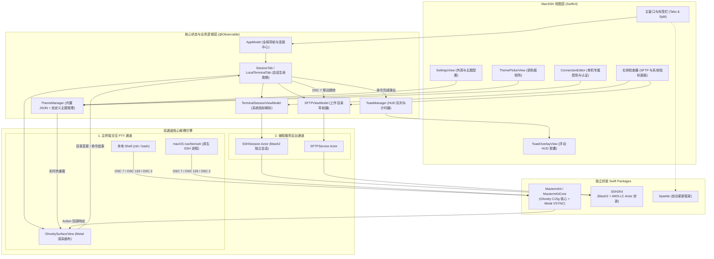

# MacSSH

[English](README.md) | [简体中文](README.zh-CN.md)

`MacSSH` 是一款专为 macOS 精心打造的原生现代 **SSH 与 SFTP 客户端**。

应用全量基于 SwiftUI 与 Swift 6 严格并发模型构建，借助 Ghostty 终端核心引擎（`MactermKit`）实现丝滑的 Metal GPU 硬件加速渲染，并通过独立的 Swift Package 模块（`SSH2Kit`）保障高并发 SSH2 会话的稳定性与安全性。

---

## 🏛️ 双通道核心架构

为了杜绝后台网络阻塞导致终端卡顿，并保持极高的系统可靠性，`MacSSH` 采用独创的 **双通道解耦架构**：

1. **主终端交互通道（PTY）**：直接通过 Ghostty 引擎运行 macOS 原生 `/usr/bin/ssh`（或用于持久化密码认证的 expect 脚本），直接依托 Metal GPU 进行硬件渲染，完整支持 ANSI TrueColor（真彩色）、原生中文/日文输入法（IME）以及语义化 Shell Integration。
2. **辅助服务通道（后台遥测与 SFTP）**：由 `SSH2Kit`（静态封装 `libssh2` 与 `AWS-LC`）提供基于 Swift Actor 隔离的 `SSHSession` 与 `SFTPService`，在后台独立执行多级目录遍历、文件传输与主机性能指标实时采集，彻底避免与主终端交互流量产生争抢。



---

## ✨ 核心特性

- ⚡ **Metal GPU 硬件加速**：基于 Ghostty 终端核心，支持 120Hz VSYNC 垂直同步、亚毫秒级输入响应，完整支持 ANSI 256 色与 24 位 TrueColor 真彩色。
- 🎨 **甄选主题生态与实时无感热切换**：内置精选自 `iTerm2-Color-Schemes` 的 110+ 款主流经典主题（Tokyo Night、Catppuccin、Nord、Dracula、Gruvbox、One Dark、Solarized、Warm Beige Cream 与 Slate Dark），支持深浅外观自动配对、单机专属覆盖，所有活跃会话实时秒级生效无需断开重连。
- 🪄 **原生 Shell 深度集成与智能 HUD 气泡**：
  - **OSC 7 目录实时跟随**：远端终端切换工作目录时，右侧 SFTP 检查器面板自动同步跳转至对应路径。
  - **OSC 0 / OSC 2 动态标题更新**：窗口与标签栏标题随远程执行程序动态呈现。
  - **零外部依赖 Toast HUD**：长耗时命令（>=5秒）执行完毕后自动弹出耗时与退出码悬浮胶囊，后台静默时联动 macOS 原生系统通知。
- 🔀 **多向分屏与本地终端**：支持水平与垂直方向多向分屏，拥有独立的 PTY 生命周期，同时支持并排运行原生 macOS 本地 Shell。
- 📊 **实时主机系统监控**：全宽微拟态胶囊进度条呈现 CPU、内存、交换分区、磁盘使用、网络实时吞吐与多核平均负载。
- 📁 **内置可视 SFTP 面板**：集成侧边栏文件管理器，支持多层目录快速浏览、拖拽上传与递归批量下载。
- 🛡️ **双通道严苛并发隔离**：100% 遵循 Swift 6 并发模型，彻底物理隔离终端交互 PTY 与后台 SFTP / 监控流量，告别卡顿与状态伪报错。
- 🔑 **系统级密钥安全管理**：智能支持 `.pub` 公钥到私钥自动推导回退，全量密码存储于 macOS 系统钥匙串（Keychain），严格执行 Host Key 变更安全校验。
- 🔄 **Sparkle 2.x 自动更新**：支持一键检查新版本，所有更新包均由 EdDSA 高强度数字签名保障。

---

## 🛠️ 源码构建

### 环境要求

1. **macOS 15.0+**（Apple Silicon / `arm64`）。
2. **Xcode 16+**（包含 macOS SDK）。
3. **Tuist**：确保已安装 Tuist（`mise install tuist` 或 `curl -fsSL https://get.tuist.io | bash`）。

### 生成与编译工程

```bash
# 1. 克隆代码仓库
git clone https://github.com/SteveShi/MacSSH.git
cd MacSSH

# 2. 通过 Tuist 生成 Xcode Workspace
tuist generate --no-open

# 3. 通过 xcodebuild 编译调试版本
xcodebuild -workspace MacSSH.xcworkspace -scheme MacSSH -configuration Debug build
```

---

## 📄 开源协议

`MacSSH` 遵循 [MIT 开源协议](LICENSE)。
