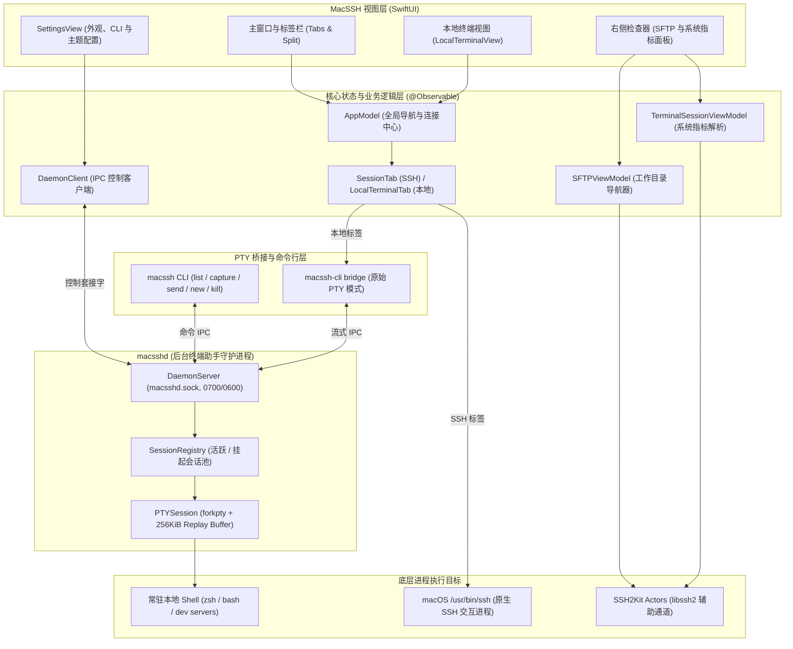

# MacSSH

[English](README.md) | [简体中文](README.zh-CN.md)

`MacSSH` 是一款专为 macOS 精心打造的原生现代 **SSH、SFTP 与本地终端客户端**。

应用全量基于 SwiftUI 与 Swift 6 严格并发模型构建，借助 Ghostty 终端核心引擎（`MactermKit`）实现丝滑的 Metal GPU 硬件加速渲染，通过独立的 Swift Package 模块（`SSH2Kit`）保障高并发 SSH2 会话的稳定性与安全性，并内置常驻终端助手守护进程（`macsshd`）与原生命令行控制工具（`macssh-cli` / `macssh`）。

---

## 🏛️ 核心架构与系统组件

为了杜绝后台网络阻塞导致终端卡顿、保障本地长任务后台保活并保持极高的系统可靠性，`MacSSH` 采用独创的 **多通道解耦与 Client–Daemon 架构**：

1. **主终端交互通道（PTY）**：直接通过 Ghostty 引擎运行 macOS 原生 `/usr/bin/ssh`（或用于持久化密码认证的 expect 脚本），依托 Metal GPU 进行硬件渲染，完整支持 ANSI TrueColor（真彩色）、原生中文/日文输入法（IME）以及语义化 Shell Integration（OSC 7 / OSC 133 / OSC 2）。
2. **常驻终端助手守护进程（`macsshd`）**：由独立后台守护进程直接持有并管理原生 POSIX 伪终端（`forkpty` + `execve`）。当用户退出 MacSSH（`Cmd+Q`）或通过 Sparkle 自动更新重启时，仅执行无损解绑（Detach），开发服务器、编译任务及长脚本在后台保持无中断运行。
3. **透明 PTY 桥接器与命令行工具（`macssh-cli` / `macssh`）**：双模可执行文件，一方面在 `GhosttySurfaceView` 内部以 `cfmakeraw` 模式流式桥接 `macsshd`，另一方面对外暴露强大的命令行控制接口，方便外部脚本、Raycast/Alfred 及 AI Agent 编程调用。
4. **辅助服务通道（后台遥测与 SFTP）**：由 `SSH2Kit`（静态封装 `libssh2` 与 `AWS-LC`）提供基于 Swift Actor 隔离的 `SSHSession` 与 `SFTPService`，在后台独立执行多级目录遍历、文件传输与主机性能指标实时采集，彻底避免与主终端交互流量产生争抢。



---

## ⚡ 常驻终端助手守护进程 (`macsshd`)

`macsshd` 是 MacSSH 专为本地终端打造的后台助手守护进程，旨在彻底解耦本地终端任务与图形窗口生命周期。

### 为什么需要 `macsshd`？

- **零中断挂起与无损恢复 (Detach & Reattach)**：当您按 `Cmd+Q` 退出 MacSSH、关闭窗口或通过 Sparkle 自动更新重启时，所有本地终端会话仅执行非破坏性的**解绑 (Detach)**，后台进程绝不会被杀死。正在运行的长耗时编译 (`cargo watch`、`make`、`xcodebuild`)、前端开发服务器 (`npm run dev`)、Docker 构建及交互式脚本在后台保持持续运行。
- **256 KiB 原始 VT 环形回放缓冲区**：`macsshd` 为每个会话在内存中保留 256 KiB 的循环输出数据流。重新打开 MacSSH 或重新附着时，原始 VT 字节流瞬间重灌入 Ghostty 解析器，完美恢复色彩、光标位置与历史滚动行，并触发 `redrawForeground()` (`kill(-pgrp, SIGWINCH)`) 强制 Vim、Htop、Claude Code 等全屏 TUI 程序立即完成整屏重绘。
- **防粘贴截断输入保护**：大段文本与 Bracketed Paste 在 macOS XNU 内核 PTY 队列 (`TTYHOG` 约 1022 字节) 满载时往往会返回 `EAGAIN` 导致丢字。`macsshd` 内置 `pendingInput` 与 `DispatchSourceWrite` 缓冲调度，确保任意长度的粘贴内容完整有序地进入 Shell。
- **非阻塞式进程回收**：使用 `waitpid(pid, &status, WNOHANG)` 在专用派发队列上轮询回收退出的子进程，杜绝控制线程死锁。
- **按需无感生命周期与安全隔离**：基于专属 Unix Domain Socket (`~/Library/Application Support/MacSSH/run/macsshd.sock`，权限 `0600`，父目录 `0700`) 与对端有效 UID 校验 (`getpeereid`) 通信。按需以独立会话组 (`POSIX_SPAWN_SETSID`) 静默拉起，并在无会话且无连接满 30 秒后自动优雅退出，零系统弹窗打扰。

---

## 💻 原生命令行工具 (`macssh` / `macssh-cli`)

`macssh-cli` 二进制文件内置于 `MacSSH.app/Contents/MacOS/macssh-cli` 中。您可以在 **设置 → 终端** 中一键安装软链接至 `/usr/local/bin/macssh`（或 `~/.local/bin/macssh`），也可手动创建：

```bash
sudo ln -sf "/Applications/MacSSH.app/Contents/MacOS/macssh-cli" /usr/local/bin/macssh
```

### 命令速查表

| 命令 | 说明 | 示例 |
| :--- | :--- | :--- |
| `macssh list` (`ls`) | 列出所有活跃及后台挂起的会话 | `macssh list` |
| `macssh capture <target>` | 捕获当前可见屏幕文本快照 | `macssh capture 1` |
| `macssh capture <target> --full` | 捕获当前屏幕以及完整的滚动回滚历史 | `macssh capture 1 --full` |
| `macssh capture <target> --last` | 仅捕获上一条执行命令的完整输出（基于 OSC 133） | `macssh capture 1 --last` |
| `macssh send <target> ...` | 向指定会话静默注入文本或 tmux 风格按键 | `macssh send 1 text "git status" key Enter` |
| `macssh new [--name] [--cwd] [-- cmd]` | 在后台创建常驻终端会话 | `macssh new --name "Build" --cwd ~/Repo` |
| `macssh kill <target>` | 终止运行中的会话 (`SIGHUP` → `SIGKILL`) | `macssh kill 1` |
| `macssh detach <target>` | 断开已挂载的客户端连接，会话保留后台运行 | `macssh detach 1` |
| `macssh status` | 检查守护进程 PID、协议版本与活跃会话数 | `macssh status` |
| `macssh ssh <[user@]host[:port]>` | 在 MacSSH 中快速唤起或聚焦指定 SSH 连接 | `macssh ssh root@example.com` |

#### `macssh send` 支持的按键词汇表

`macssh send` 原生兼容全部 `tmux send-keys` 按键名称：
```text
Enter, Return, Tab, Escape, Esc, Space, BSpace, Backspace, Delete, DC, IC, Insert,
Up, Down, Right, Left, Home, End, PgUp, PgDn, F1-F12, C-<key>, M-<key>
```

#### 常见使用场景

```bash
# 1. 在后台创建一个常驻前端开发服务器
macssh new --name "WebDev" --cwd ~/Projects/my-app -- npm run dev

# 2. 查看当前正在运行的会话列表
macssh list
# 输出:
# ID  NAME    PROCESS  PID    SIZE   STATE     DIRECTORY             KEY
# 1   WebDev  node     82140  80x24  detached  ~/Projects/my-app     a1b2c3d4...

# 3. 从其他脚本或终端抓取该服务当前的屏幕输出
macssh capture 1

# 4. 发送 Ctrl+C 优雅停止该服务
macssh send 1 key C-c
```

---

## ✨ 核心特性

- ⚡ **Metal GPU 硬件加速**：基于 Ghostty 终端核心，支持 120Hz VSYNC 垂直同步、亚毫秒级输入响应，完整支持 ANSI 256 色与 24 位 TrueColor 真彩色。
- 🛡️ **Client–Daemon 会话持久化 (`macsshd`)**：本地终端在后台守护进程中运行。退出 App 或 Sparkle 更新自动解绑不杀进程，重新打开瞬间回放 256 KiB 屏幕状态。
- 💻 **原生自动化命令行 (`macssh`)**：提供无头列出会话、屏幕快照捕获、按键注入与静默会话创建的全套命令行接口。
- 📦 **后台会话可视化管理**：支持一键“将标签页转入后台 (`Cmd+Shift+D`)”，工具栏“后台会话”菜单直观展示挂起状态，支持随时一键无损找回。
- 🎨 **甄选主题生态与实时无感热切换**：内置 110+ 款主流经典主题（Tokyo Night、Catppuccin、Nord、Dracula、Gruvbox、One Dark、Solarized、Warm Beige Cream 与 Slate Dark），支持深浅外观自动配对与实时热切换。
- 🪄 **原生 Shell 深度集成与智能 HUD 气泡**：
  - **OSC 7 目录实时跟随**：远端终端切换工作目录时，右侧 SFTP 检查器面板自动同步跳转至对应路径。
  - **OSC 0 / OSC 2 动态标题更新**：窗口与标签栏标题随执行程序动态呈现。
  - **零外部依赖 Toast HUD**：长耗时命令（>=5秒）执行完毕后自动弹出耗时与退出码悬浮胶囊，后台静默时联动 macOS 原生系统通知。
- 🔀 **多向分屏与本地终端**：支持水平与垂直方向多向分屏，拥有独立的 PTY 生命周期，同时支持并排运行原生 macOS 本地 Shell。
- 📊 **实时主机系统监控**：全宽微拟态胶囊进度条呈现 CPU、内存、交换分区、磁盘使用、网络实时吞吐与多核平均负载。
- 📁 **内置可视 SFTP 面板**：集成侧边栏文件管理器，支持多层目录快速浏览、拖拽上传与递归批量下载。
- 🛡️ **双通道严苛并发隔离**：100% 遵循 Swift 6 并发模型，彻底物理隔离终端交互 PTY 与后台 SFTP / 监控流量。
- 🔑 **系统级密钥安全管理**：智能支持 `.pub` 公钥到私钥自动推导回退，全量密码存储于 macOS 系统钥匙串（Keychain），严格执行 Host Key 变更安全校验。
- 🔄 **Sparkle 2.x 自动更新**：支持一键检查新版本，所有更新包均由 EdDSA 高强度数字签名保障。

---

## 🛠️ 源码构建

### 环境要求

1. **macOS 15.0+**（Apple Silicon / `arm64`）。
2. **Xcode 16+**（包含 macOS SDK）。
3. **Tuist**：确保已安装 Tuist（`mise install tuist` 或 `curl -fsSL https://get.tuist.io | bash`）。

### 生成与编译工程

```bash
# 1. 克隆代码仓库
git clone https://github.com/SteveShi/MacSSH.git
cd MacSSH

# 2. 通过 Tuist 生成 Xcode Workspace
tuist generate --no-open

# 3. 通过 xcodebuild 编译调试版本
xcodebuild -workspace MacSSH.xcworkspace -scheme MacSSH -configuration Debug build
```

---

## 📄 开源协议

`MacSSH` 遵循 [MIT 开源协议](LICENSE)。
